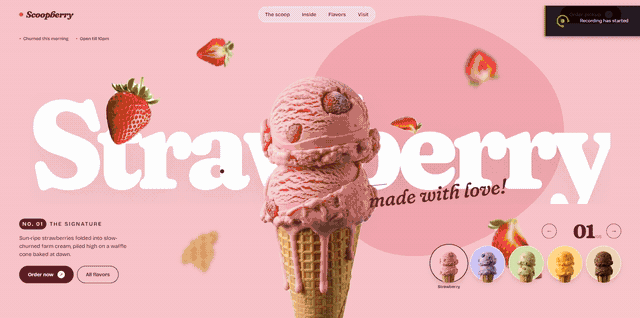
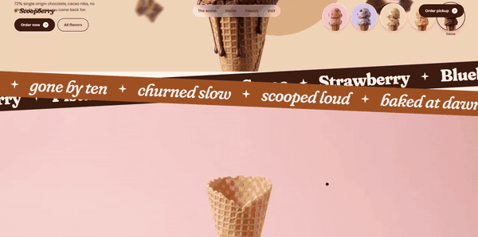

# Scoopberry — Cinematic Gelato Landing Page

A playful, motion-heavy landing page for a fictional small-batch gelato shop. A real, photographic ice cream cone turns slowly in front of giant type. Pick one of five flavors and the whole page re-themes with a circle wipe: background, colors, the cone itself, the floating ingredients around it, and both scroll-driven video stories below. The page is a single HTML file with no build step.

**Live demo:** <https://still-hall-2565.dnanima895.workers.dev/>





## Features

- **Real cone cut out of AI video.** Every flavor's rotating cone comes from its own 5-second clip. It is keyed out of the studio background with temporal smoothing so the edges don't flicker, then aligned to the same size and position across all flavors.
- **Flavor switcher.** Five flavors (Strawberry, Blueberry, Pistachio, Mango, Cocoa). Switching runs a circle-wipe theme change, a letter-by-letter swap of the giant word, a spin of the cone and a "pop" swap of the floating ingredients.
- **Scroll-scrubbed video stories.** "Build your cone" and "What's inside" are pinned sections that scrub through 470 motion-interpolated frames (96 fps) drawn to a canvas. They swap to the selected flavor's footage, and the ingredient labels change with it.
- **Cinematic intro.** A loading screen with a live percentage counter tracks real asset loading, then a curtain reveal and staggered entrance.
- **Motion system.** Lenis smooth scrolling, GSAP + ScrollTrigger choreography, custom cursor, magnetic buttons, a marquee that speeds up with scroll velocity, and a cursor-following flavor preview on the menu.
- **Responsive.** The layout recomposes for phones, phones load half the frames, pins stay stable when the mobile address bar moves, and there's a `prefers-reduced-motion` path.

## Tech stack

- Plain HTML / CSS / JavaScript (single `index.html`)
- [GSAP 3.13](https://gsap.com/) + ScrollTrigger
- [Lenis](https://github.com/darkroomengineering/lenis) smooth scroll
- Canvas 2D frame sequences (WebP)
- Asset pipeline: ffmpeg (frame extraction + `minterpolate` motion interpolation) and Python/NumPy/SciPy (background keying, temporal mask smoothing, alignment)
- Fonts: Fraunces + Bricolage Grotesque (Google Fonts)

## Run locally

The page loads its frames over HTTP, so serve the folder instead of opening the file directly:

```bash
python -m http.server 8000
```

Then open <http://localhost:8000>.

## Deploy

The folder is ready for static hosting (Cloudflare Pages, Netlify, GitHub Pages). `_headers` sets long-term caching for `/assets/*` on Cloudflare Pages. Assets use `?v=` query strings for cache busting.

## Project structure

```
index.html          # page, styles and all motion code
assets/cone/        # strawberry rotating cone (cut-out frames)
assets/flv/<flavor>/        # each flavor's rotating cone
assets/flv/<flavor>/build/  # "build your cone" scroll frames
assets/flv/<flavor>/burst/  # "what's inside" scroll frames
assets/build, assets/burst  # strawberry scroll frames
assets/bits/        # floating ingredient cut-outs
media/              # README demo GIFs
```

---

Scoopberry is a fictional brand created for this design concept.
